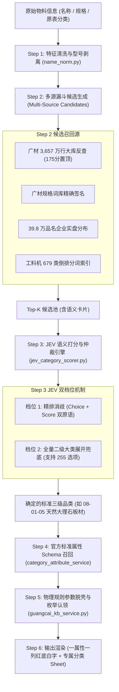

# 广材标准分类与 JEV 语义模型配合机制与规则白皮书 (RULEBOOK v1.0)

## 一、 核心架构协同总览

整个物料标准化链路分为 6 个严格阶段，实现从原始混乱的报价行到权威标准三级分类及一属性一列的闭环：

---

## 二、 关键比对与仲裁规则 (Matching & Arbiter Rules)

### 1. JEV 双档位判定规则
- **档位 1 (精排消歧)**：
  - 输入：物料名称、规格、供应商、品牌、以及整表计算得出的主业先验 `dominant_t2`。
  - 将每个候选组装成富语义判定卡片：`【一级 > 二级 > 三级】 | 核心属性:[...] | 证据:...`。
  - 彻底杜绝歧义（如“输入模块”既可能出现在消防弱电，也可能出现在自动化，通过主业先验消歧）。
- **档位 2 (全量二级大类展开兜底)**：
  - 当词表未覆盖该生僻新词、或档位 1 得分低于 `JEV_MIN_CONFIDENCE (0.60)` 时触发；
  - 利用 JEV 单次容纳 255 个选项的闭卷推理能力，将所属二级大类下全量三级类别展开，由 JEV 闭卷精准直选。

### 2. 官方标准属性 Schema 召回规则
- 通过选中的 `category_code`，从 `category_attribute_schema` 或 `category_attrs_cache.json` 调取该品类官方定义的标准属性。
- 保证表头严格按官方标准属性列排布（如圆钢为 `品种, 直径(mm), 牌号`；大理石为 `品种, 厚度(mm), 长宽(mm), 表面处理, 等级`）。

### 3. 物理规则参数脱壳规则 (Physical Unpacking)
- **几何多维尺寸**：识别 `800*800*20`、`600*1200*18`，自动拆解：长=800、宽=800、厚度=20。
- **管材外径与壁厚**：识别 `De50*2.0`、`dn20*2.0mm`，自动拆解：公称外径De(mm)=50、壁厚(mm)=2.0。
- **通径 DN**：识别 `DN50`、`通径25`，自动拆解并剥离 `DN` 前缀填入纯数字 `50`。
- **钢筋线材**：识别 `Φ18`、`φ12`，自动拆解：直径(mm)=18。
- **单位脱壳规范**：当标准属性列已带有单位（如 `厚度(mm)`），提取出来的值必须脱掉冗余单位（如 `20mm` 必须脱壳清洗为 `20`）。
- **专有枚举反向自动认领**：若原始规格中明确出现官方 Schema 专有枚举（如 `聚酯胎PY`、`Q235B`、`抛光面` 等），自动认领填入对应标准列。
