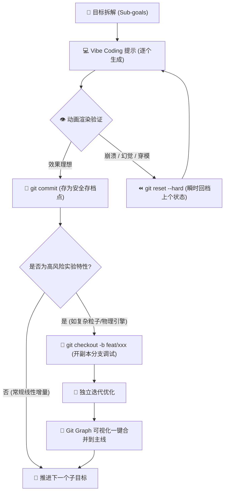

# Vibe Coding 与 Git 结合实现动画开发：像打游戏存档一样做 3D 动画

> **金句心法**  
> *"Vibe coding with Git 就是在 play game —— 崩了能回，爽了能留，复杂动画也能慢慢 vibe 出来。"*

---

## 故事篇：猫学长的“通关秘籍”

猫学长最初面对 3D 动画开发手足无措，复杂的顶点计算、Three.js 的层级嵌套，加上时灵时不灵的 AI 生成代码，常常让代码在一次大改动之后彻底黑屏报错。

直到他突然悟出一个道理：**Git 不就是 3D 世界的游戏自动存档点（Checkpoint）吗？**

当他为猫小白设计“自适应动态运镜”时，AI 连续三次把相机拉到了穿模的外太空。猫学长没有焦虑地狂按 `Ctrl+Z` 或在凌乱的代码里找 bug，而是神情淡定地敲下一行 `git reset --hard HEAD`，瞬间满血复活回到上一个稳定渲染状态。

接着，他在独立的 `feat/battery-anim`（电池小动画）分支上反复调试了七次：从电池外壳透明度、电量粒子流动，到低电量呼吸警报。第七次测试通过后，他点开 VS Code 的 **Git Graph**，轻轻一点，将这段丝滑的动画完美合并到了主线（main 分支）。

**就这样，通过一次次精准的 commit 存档，原本庞大不可控的 3D 复杂动画，被拆成了一个个通关副本。对话一改，运镜自适应同步，猫小白的动态 3D 世界就这么活了过来！**

---

## 架构篇：核心工具与逻辑全景

---

## 四大核心模块

| 模块 | 核心关键词 | 核心逻辑与实践价值 |
| :--- | :--- | :--- |
| **① 核心工具组合** | `Vibe Coding` | 用代码（如 Three.js / WebGL / Remotion）动态驱动 3D 场景，加入**自适应运镜算法**，当对话台词或节奏变化时，镜头与动作曲线自动重新计算，免去手动重切关键帧。 |
| **② 开发流程** | `线性开发 (Step-by-step)` | **拒绝一次性喂给 AI 超长 Prompt**。将大场景拆解为：场景底座 ➔ 核心模型 ➔ 静态贴图 ➔ 基础旋转 ➔ 运镜与光影 ➔ 粒子特效，分步推进。 |
| **③ 版本控制** | `Git 基础操作` | 建立心智模型：`commit` = 存档，`checkout` = 读档/穿越时空，`reset` = 投币复活，`branch` = 开新档试错，试错失败直接弃档，主线毫发无损。 |
| **④ 可视化工具** | `Git Graph` | VS Code 插件提供如地铁线路图般直观的分支图谱。支持右键一键 cherry-pick、checkout 与 reset，配合清晰中文提交信息，极大幅度降低认知负荷。 |

---

## 实战 SOP：五步通关法

1. **装好雷达**：在 VS Code 插件市场安装 `Git Graph`，打开左侧源代码管理底部的图谱面板。
2. **切碎目标**：明确每个 commit 只解决**一个最小物理视觉单位**（例如：“完成了地面网格渲染”）。
3. **隔离试错**：凡遇到高难度（如骨骼动画、布料解算、流体模拟），果断 `git checkout -b experiment/xxx`，随意让 AI 暴力折腾。
4. **一键回滚**：如果 AI 陷入幻觉开始删改全局上下文，不要试着用自然语言跟它吵架修正，直接 `git reset --hard HEAD`，精简并修正提示词后重新发起生成。
5. **对标精进**：深度学习优秀开源实践（如 `vibe-motion/skills`），复用运镜与时间轴插值（lerp/easing）的最佳范式代码块。

---

## 常用命令与“游戏心智”对照表

- `git checkout -b exp-lens` ➔ **开个平行宇宙副本，随便造**
- `git commit -am "feat: 完成第一视角向全景自适应平滑推镜"` ➔ **打倒一个小 Boss，敲下存档键**
- `git reset --hard HEAD` ➔ **踩雷掉血，立刻读档满血复活**
- `git merge exp-lens` ➔ **副本挑战成功，把强力装备收回主背包**
