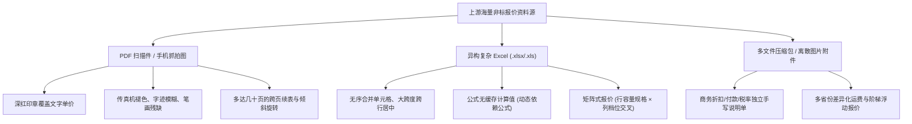
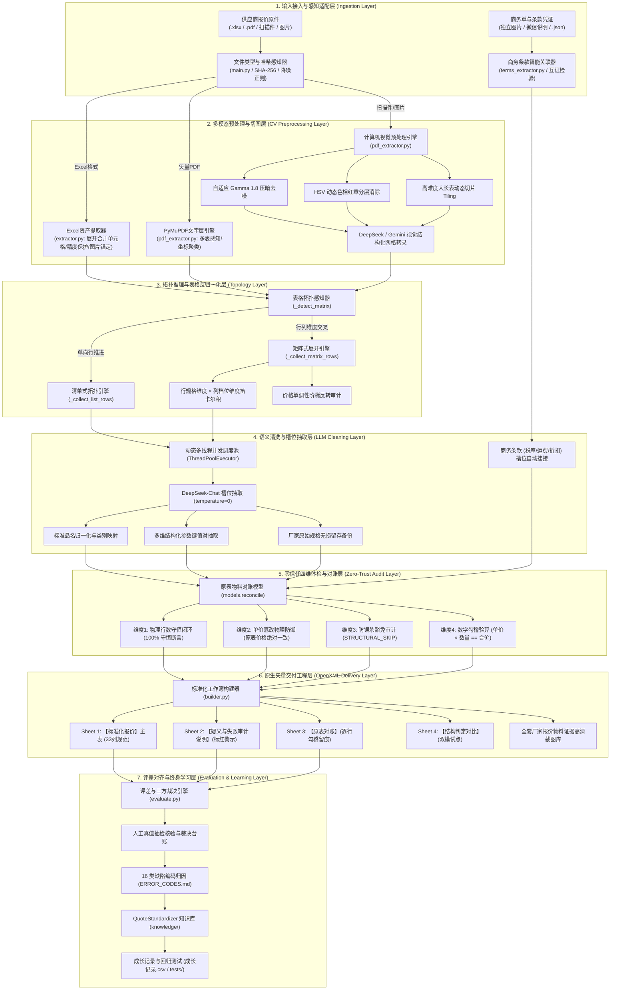
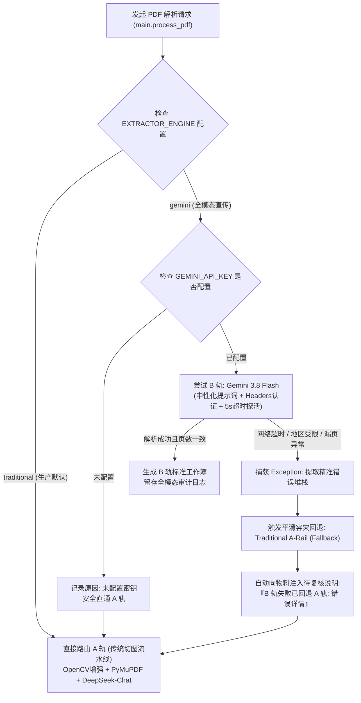
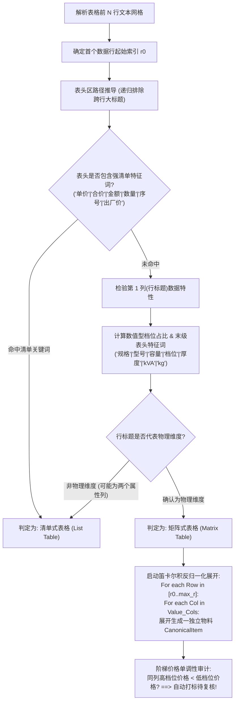
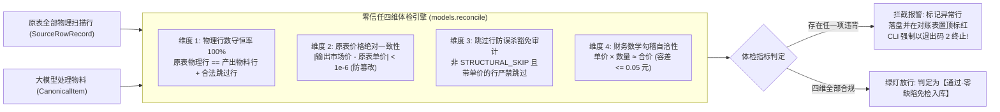
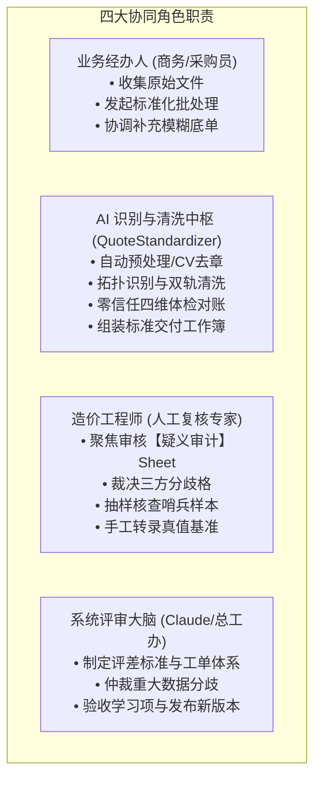
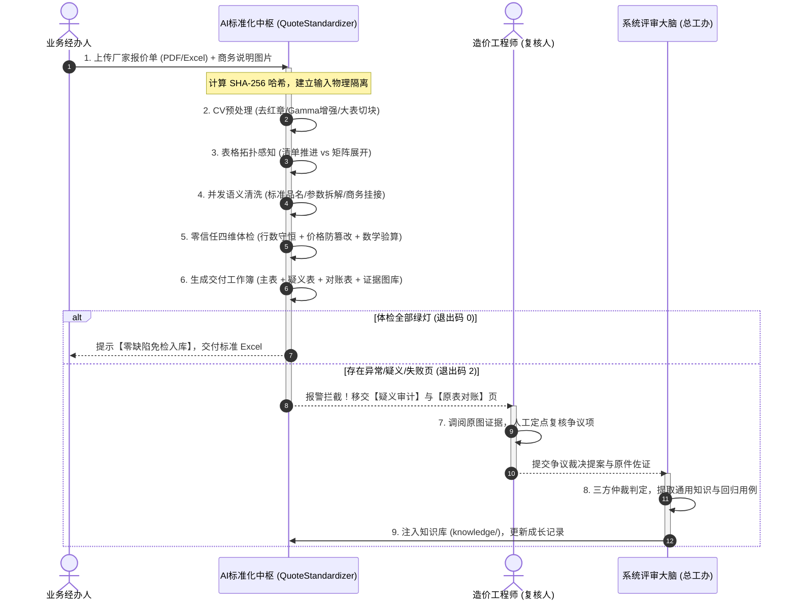

# 建材报价单标准化解析与全参数评差系统（QuoteStandardizer）
## 全景系统架构、核心技术方案与端到端业务实施规程（SOP）全景白皮书

> **系统名称**：QuoteStandardizer（企业级建材报价单多模态标准化解析与零信任评差对账系统）  
> **文档版本**：v3.2 Enterprise Architecture  
> **编写团队**：工程架构与业务对账联合专家组  
> **代码仓库**：[GitHub - qianqianbaobei1/QuoteStandardizer](https://github.com/qianqianbaobei1/QuoteStandardizer)  
> **归档位置**：`codex/日常办公/建材报价单标准化解析系统_全景架构与技术业务方案.md`  
> **适用对象**：系统架构师、造价工程师、商务采购经理、AI 算法工程师、业务专家评审委员会  

> **⚠️ 实现现状声明（优先于下文所有 Sheet 描述）**：当前交付形态为**单 Sheet**——主交付文件只有「标准化报价」一张工作表，
> 审计分级以**主表整行红字黄底 + 市场价批注**呈现；对账与四维体检明细落在**独立文件** `<供应商>_对账与防欺瞒体检报告.xlsx`。
> 下文提到的「疑义与失败审计说明」「原表对账」「结构判定对比」三张 Sheet 为**历史方案**，不再随主交付输出；
> `STRUCTURE_ENGINE=compare` 当前与 `gemini` 同链路，暂不产出对比表。

---

## 目录（Table of Contents）

1. [项目背景与核心业务使命](#第一篇项目背景与核心业务使命)
   - 1.1 业务核心痛点与非标困局
   - 1.2 系统的根本目标与三大终极检验标准
   - 1.3 底层工程铁律与不可侵犯的不变式（Invariants I1–I9）
2. [总体系统架构设计（Technical Architecture）](#第二篇总体系统架构设计technical-architecture)
   - 2.1 整体分层拓扑架构图
   - 2.2 八大核心子系统全景拆解
   - 2.3 核心工程模块与代码职责矩阵
3. [核心技术攻坚方案深度剖析（Deep-Dive Technical Solutions）](#第三篇核心技术攻坚方案深度剖析deep-dive-technical-solutions)
   - 3.1 双轨智能流水线调度与平滑容灾回退
   - 3.2 扫描件计算机视觉（CV）预处理矩阵
   - 3.3 大长表动态切块与全局坐标投影重映射
   - 3.4 矩阵式 vs 清单式表格自适应拓扑感知与反归一化算法
   - 3.5 大模型结构化清洗、槽位提取与并发吞吐控制
   - 3.6 零信任防欺瞒四维体检与行数守恒闭环体系
   - 3.7 100% 原生矢量 OpenXML 构建与可审计证据链落盘
4. [端到端业务方案与业务旅程（Business Workflow & SOP）](#第四篇端到端业务方案与业务旅程business-workflow--sop)
   - 4.1 四大业务协同角色分工矩阵
   - 4.2 报价单处理全生命周期泳道图
   - 4.3 八步端到端业务操作规程（SOP 实施细则）
5. [质量保障、评差对齐与终身学习成长机制](#第五篇质量保障评差对齐与终身学习成长机制)
   - 5.1 严苛验收口径：单份零差异准入法则
   - 5.2 16 类工业级缺陷分类字典（E01–E16）
   - 5.3 九步自进化成长闭环与首测/学习后双成长度量
6. [系统运行环境、配置规约与部署维护手册](#第六篇系统运行环境配置规约与部署维护手册)
   - 6.1 依赖环境与 `.env` 配置参数全景表
   - 6.2 CLI 核心命令与多场景执行范例
   - 6.3 系统退出码与监控报警规范

---

# 第一篇：项目背景与核心业务使命

## 1.1 业务核心痛点与非标困局

在建筑工程、大型基建与工业品招投标采购业务中，材料设备价格是决定工程总造价与企业利润的核心命脉。然而，由于上游建材供应商与生产厂家数以万计，各家企业的信息化水平参差不齐，提交的“厂家报价单”呈现出极其恶劣的**非结构化、高度异构、重度非标**状态：



长期以来，行业内普遍采用纯人工“肉眼扒表 + 逐行录入”或直接套用通用大语言模型直接识别。这引发了极其严重的致命问题：
1. **模型幻觉篡改价格（致命事故）**：通用大语言模型在直接读取密集表格时，极易发生“看错行、对错列、数字胡编”的幻觉现象（例如将原件 400,000 元误识别为 100,000 元，或将 900 元灌浆料误填为 6 元），直接导致招投标发生数百万级重大经济损失；
2. **矩阵式折叠无法拆解**：大量电缆、变压器、型材采用“行标题（规格容量）× 列标题（电压/档位/标准）”二维交叉表，传统 OCR 只能按行死读，导致价格与规格严重错位；
3. **商务条件离散遗漏**：厂家最关键的“工程折扣（如面价下浮 35%）”、“税率 13%”、“是否包运费到工地”等关键商务条件往往写在盖章的独立附页或微信聊天截图上，极易被常规流水线整单遗漏；
4. **缺乏对账证据链，评审专家无法采信**：传统 AI 工具输出只是一个冷冰冰的结果表，一旦出现分歧，无法证明 AI 的输出到底来自原单的哪一页、哪一行、哪一列，现场专家评审时极易被一票否决。

## 1.2 系统的根本目标与三大终极检验标准

`QuoteStandardizer` 的立项宗旨是：**打造国家级建设工程造价与集采风控标准的自动化解析引擎，彻底终结非标建材报价单的混乱现状。**

系统在工程上必须满足三大终极检验标准：
- **第一准则：对的就是对的，错的就是错的**。唯一的事实基准永远是“原单原件”。程序输出、人工整理的草稿、模型自报的所谓“高置信度”，均不具备天然真值效力；
- **第二准则：错了自己能发现（零漏报红线）**。每一个疑难格、印章遮挡、模糊点，要么被系统自动化算法精准标记并留痕，要么被对账与体检引擎当场拦截，**绝对不允许“错了但没有任何人知道”**；
- **第三准则：发现了就能持续进化**。所有经人工裁决的真伪案例，自动转化为知识库条目与永久回归测试用例，确保修复的代码永远不再复发同类错误。

## 1.3 底层工程铁律与不可侵犯的不变式（Invariants I1–I9）

在系统整个生命周期内，任何代码提交、算法调优与提示词修改，均受以下 **9 大不可侵犯不变式（Invariants）** 绝对约束：

> [!CAUTION]
> ### 🚨 架构最高安全红线：九大底层不变式（Invariants）
> 1. **I1【价格只取原表】**：输出的“市场价”必须百分之百等于原表（或转录网格）单元格中的原始数字；大模型分析出的单价只允许用于交叉核验，**严禁使用模型生成的值覆盖或修改原表价格**！
> 2. **I2【不知则严格留空】**：原件中未提供的信息（如无折扣、无税率、无品牌、无产地、无类别编码），**严禁填充任何假定默认值**，一律留空并打上待复核标签！
> 3. **I3【推断必须显式留痕】**：凡是通过规则推断生成的字段（如由文件名推断供应商、由公司名截取品牌、由算法归一化单位），必须在每条物料的待复核说明及审计表中显式记录“由 XX 推断”！
> 4. **I4【存疑必须逐级透传】**：任何在视觉层被标记为 `cell_issue`（公章遮挡、笔画模糊、双读分歧）的单元格，其生成的标准物料必须在说明中保留完整原因，不得静默抹平！
> 5. **I5【每条输出必须物理可溯源】**：交付表的每一条物料必须携带精确物理坐标 `source_ref`（如 `第1页!R12C4` 或 `Sheet1!R8`），并与「原表对账」Sheet 形成一一对应关系！
> 6. **I6【原文规范不予篡改】**：原件中已是标准“键:值;”格式的规格参数原样保留；厂家原始单位、用字、标点禁止过度脑补替换！
> 7. **I7【故障隔离与显式暴露】**：多页文档中若某一页因极度污损无法识别，系统必须实现页面级故障隔离，确保其他健康页正常解析输出，并在对账中显式记录失败页及原因，退出码置为 2，严禁全单静默放弃！
> 8. **I8【默认基线稳定不变】**：未经严格基准测评与专家委员会批准，任何实验性分支（如全模态直传、实验性规则）不得擅自更改生产默认流水线！
> 9. **I9【严禁业务硬编码】**：严禁针对某一家特定供应商名称、特定商品型号编写“特事特办”的代码分支；所有规则必须具备跨品类通用性！

---

# 第二篇：总体系统架构设计（Technical Architecture）

## 2.1 整体分层拓扑架构图

系统采用现代松耦合、高度可观测的“流水线微内核 + 防欺瞒守恒闭环”分层架构设计：



## 2.2 八大核心子系统全景拆解

整个系统划分为相互独立、职责清晰的八大子系统：

1. **输入适配与环境感知子系统**：负责探测输入文件格式、计算文件唯一 SHA-256 校验和、进行文件名噪音过滤、动态感知提取供应商主体名称，并在同级目录自动侦测配对商务单据图片。
2. **多模态 CV 图像增强与切片子系统**：针对低质、褪色、带公章遮挡的扫描件 PDF 及图片，提供基于 OpenCV 的色彩空间分离（去红章）、非线性灰度 Gamma 压暗；对超长表格提供行数探测与重叠条带（Tiling）切块。
3. **表格拓扑感知与反归一化子系统**：自动识别表格形态是常规的“清单式（List）”还是具有交叉维度的“矩阵式（Matrix）”。对矩阵式执行笛卡尔积双向平铺展开，并内置价格单调性倒挂自检。
4. **大语言模型语义清洗与槽位对齐子系统**：基于确定性大语言模型（`temperature=0`）对提取出的非标物料行执行语义理解，精准抽取产品品名、结构化技术参数（规格/材质/厚度/容量/型号），并自动挂接商务条款。
5. **零信任防欺瞒四维体检子系统**：系统的核心风控防线。脱离大语言模型自评，基于严格的离散数学与财务勾稽公式，执行原表物理行守恒核算、价格篡改拦截、跳过行防误杀审计及乘积数学验算。
6. **100% 原生矢量 OpenXML 构建子系统**：基于底层 OpenXML 规范纯代码驱动生成 Excel 工作簿，严禁网页全屏死图贴装；生成包含主数据表、标红疑义审计表、原表对账表、判定对比表的完整多表凭证体系。
7. **全参数评差与三方裁决子系统**：支持将本地标准解析成果、第三方线上系统成果与人工核实的原单真值进行逐格对齐，自动生成多维度合格率、Wilson 95% 置信区间及缺陷归因台账。
8. **自进化知识库与持续成长子系统**：将人工核查提炼的表头别名、单位等价词、排版形态规律外置为 YAML 知识库，结合自动化回归测试与难例提示词库，推动系统性能随批次单向累积成长。

## 2.3 核心工程模块与代码职责矩阵

| 模块文件 | 核心类 / 核心函数 | 核心工程职责 | 依赖项 / 输入输出 |
|---|---|---|---|
| [`main.py`](file:///Users/qianqianawodebaobei/PycharmProjects/QuoteStandardizer/main.py) | `process_excel`<br>`process_pdf`<br>`standardize_workbook`<br>`_finish`<br>`main` | **主调度控制中枢**：协调端到端流水线，执行双轨路由、表格类型分支调度、多线程批处理清洗、失败页面隔离、完整性校验与 CLI 退出码判定。 | 输入：命令行参数、原件文件<br>输出：`(output_xlsx, failures)`，退出码 0/1/2 |
| [`pdf_extractor.py`](file:///Users/qianqianawodebaobei/PycharmProjects/QuoteStandardizer/pdf_extractor.py) | `PDFTableExtractor`<br>`_grids_from_vision`<br>`_remove_red`<br>`_apply_gamma` | **PDF 与扫描件切片抽取器**：PyMuPDF 矢量解析、OpenCV 色彩空间红章消除、Gamma 压暗、长表自适应 Tiling 切块、调用视觉模型转录结构化网格。 | 依赖：`fitz`, `cv2`, `PIL`, `numpy`<br>输出：标准 `openpyxl.Workbook` + `cell_issue` 字典 |
| [`gemini_pdf_extractor.py`](file:///Users/qianqianawodebaobei/PycharmProjects/QuoteStandardizer/gemini_pdf_extractor.py) | `GeminiPDFTableExtractor`<br>`to_workbook` | **B 轨原生全模态直传流水线**：Gemini 3.8 Flash 原生多模态解析（含中性化提示词、Header 传 Key、快速探活超时与自动降级 A 轨）。 | 依赖：`google.genai` SDK / 官方 REST API<br>输出：全模态转录 Workbook |
| [`extractor.py`](file:///Users/qianqianawodebaobei/PycharmProjects/QuoteStandardizer/extractor.py) | `ExcelAssetExtractor`<br>`unmerge_and_fill_cells`<br>`safe_clean_price` | **Excel 资产解析与规范化引擎**：合并单元格向下/向右完全展开填充、高精度浮点截断防护、公式无缓存探测、WPS 嵌入式图片几何锚定提取。 | 依赖：`openpyxl`<br>输入：原始 `.xlsx`/`.xlsm`<br>输出：无合并单元格的双份只读工作簿 |
| [`terms_extractor.py`](file:///Users/qianqianawodebaobei/PycharmProjects/QuoteStandardizer/terms_extractor.py) | `TermsExtractor`<br>`verify_terms_supplier`<br>`normalize_terms` | **商务条款多模态抽取器**：同目录商务单据（PNG/JPG）自动感知与检索、付款/运费/税率/折扣视觉抽取、印章多方互证校验、省份标准化。 | 依赖：多模态视觉 API<br>输出：结构化商务字典 `terms_dict` |
| [`llm_agent.py`](file:///Users/qianqianawodebaobei/PycharmProjects/QuoteStandardizer/llm_agent.py) | `DeepSeekStandardizer`<br>`JevJudge` | **语义清洗与槽位对齐智能体**：调用 DeepSeek-Chat 执行表格结构推导与物料槽位标准化（品名/规格/单位）；支持 Jev 概率决策微调。 | 依赖：DeepSeek API<br>输出：标准品名、参数字典 `structured_specs` |
| [`models.py`](file:///Users/qianqianawodebaobei/PycharmProjects/QuoteStandardizer/models.py) | `CanonicalMaterialItem`<br>`SourceRowRecord`<br>`reconcile` | **核心数据模型与零信任对账引擎**：定义 33 列标准化物料模型与原表物理行记录；执行四维防欺瞒体检、行数守恒校验与数学勾稽。 | 输入：`source_rows`, `items`<br>输出：`(recon_report, integrity_summary)` |
| [`builder.py`](file:///Users/qianqianawodebaobei/PycharmProjects/QuoteStandardizer/builder.py) | `StandardizedWorkbookBuilder`<br>`build_from_canonical_items` | **100% 原生矢量工作簿构建器**：构建 33 列表头主表、宋体红色警示的疑义审计表、原表逐行对账表、判定对比表；写入 Git 提交号元数据。 | 依赖：`openpyxl`<br>输出：最终交付级 `.xlsx` 工作簿及高清图片库 |
| [`evaluate.py`](file:///Users/qianqianawodebaobei/PycharmProjects/QuoteStandardizer/evaluate.py) | `evaluate_vendor`<br>`run_evaluation_batch` | **全参数评差与指标度量引擎**：行对齐对账、单位/单价/规格归一化比对、16 类缺陷编码归因、整单合格率与 Wilson 95% 置信区间计算。 | 依赖：人工真值表、配对清单<br>输出：全景评差总表与缺陷证据台账 |
| [`health_check.py`](file:///Users/qianqianawodebaobei/PycharmProjects/QuoteStandardizer/health_check.py) | `run_health_check` | **系统运行时健康自检探针**：端到端连通性测试、API 密钥与网络探针、OpenXML 读写验证、核心不变式回归快速扫描。 | 输出：系统健康度检测报告 |

---

# 第三篇：核心技术攻坚方案深度剖析（Deep-Dive Technical Solutions）

## 3.1 双轨智能流水线调度与平滑容灾回退

针对大模型 API 存在的区域可用性差异、网络阻塞及偶发超时风险，系统设计了工业级的**双轨智能调度中枢（Dual-Rail Dispatcher）**：



- **安全认证规范**：完全摒弃在 URL Query 参数中拼接 API 密钥的不安全做法，统一在 HTTP 请求头中以 `x-goog-api-key: GEMINI_API_KEY` 传递；
- **全流程无损留痕**：一旦发生降级回退，回退诱因不仅在控制台打印警告，还会自动沉淀到物料的 `uncertainty_note` 字段、输出工作簿的「疑义与失败审计说明」Sheet 以及「结构判定对比」Sheet 中，确保生产可审计性。

## 3.2 扫描件计算机视觉（CV）预处理矩阵

针对建材行业普遍存在的“公章压盖关键单价”、“多重复写复印褪色笔画”、“手机拍照暗角阴影”等恶劣图像输入，`pdf_extractor.py` 构建了基于 OpenCV 的多重图像增强流水线：

```
[原始扫描页面 300DPI PNG]
       │
       ├─► 通道 1：RGB → HSV 色彩空间转换
       │       │
       │       ├─► 红色双峰区间阈值过滤：
       │       │   Mask1: H ∈ [0, 10], S ∈ [40, 255], V ∈ [40, 255]
       │       │   Mask2: H ∈ [160, 180], S ∈ [40, 255], V ∈ [40, 255]
       │       │
       │       └─► 图像修复与背景白色置换 (cv2.inpaint / 阈值替换)
       │           ==> 彻底消除公章红色油墨遮挡，裸露出底部黑色数字笔画！
       │
       └─► 通道 2：非线性 Gamma 灰度变换矩阵
               │
               ├─► 灰度化：Gray = 0.299R + 0.587G + 0.114B
               │
               └─► 查找表映射：Pixel_out = 255 × (Pixel_in / 255) ^ (1 / 1.8)
                   ==> 压暗浅色细微褪色笔画，将断裂的“400000”字迹强化连接，杜绝误读为“100000”！
```

经过 CV 预处理增强后，送入视觉模型的图片清晰度与对比度大幅提升，配合 `VISION_DOUBLE_CHECK` 双读校验机制（第一遍读增强图，第二遍读原图，差异格自动进入存疑队列），大幅提升了扫描件价格识别的鲁棒性。

## 3.3 大长表动态切块与全局坐标投影重映射

通用视觉大模型在单次推理单页表格超过 40–50 行时，极易发生注意力发散、尾部行静默截断或行序号错位。系统在 `pdf_extractor.py` 中实现了**自适应分块重叠加权拼接算法（Tiling & Global Projection）**：

1. **行数自适应评估**：首先利用霍夫变换或快速版面分析预估页面物理表格行数；
2. **重叠条带切分（Tiling）**：当预估行数超过阈值（`VISION_MAX_ROWS_PER_TILE=40`）时，自动将高分辨率大图沿 Y 轴切分为若干水平条带，条带之间保留 `VISION_TILE_OVERLAP_ROWS=2` 行作为重叠基准；
3. **全局坐标线性重映射**：
   $$\text{Global\_Row} = \text{Local\_Row} + \text{Tile\_Row\_Offset}$$
   条带内部模型自报的存疑单元格（`uncertain`）及坐标定位，统一累加起始偏移量，确保拼接后的大表格与原件全页在物理几何层面 100% 像素级对齐；
4. **列宽与列数一致性强校验**：各切片条带返回的列数若与首个条带不一致，严禁静默补齐或丢弃，整条带直接写入 `cell_issue`（“切块列数不一致”），坚决阻断由于截断引发的连锁错位。

## 3.4 矩阵式 vs 清单式表格自适应拓扑感知与反归一化算法

建材行业两大典型版式在数据拓扑上存在本质区别：
- **清单式（List Table）**：典型“一行一物料”，包含明确的单价列、数量列、单位列；
- **矩阵式（Matrix Table）**：典型“多维交叉”，行是规格/容量（如 `30kVA`, `50kVA`），列是技术档位/执行标准（如 `S13型(NX3)`, `S20型(NX2)`），交叉格即为单价。

系统在 [`main.py:_detect_matrix`](file:///Users/qianqianawodebaobei/PycharmProjects/QuoteStandardizer/main.py#L315) 中建立了严密的拓扑特征感知模型：



通过这一自适应算法，彻底解决了传统解析将矩阵表误读为大段备注或丢失 80% 价格组合的行业顽疾。

## 3.5 大模型结构化清洗、槽位提取与并发吞吐控制

在从表格物理网格提取出原始行后，非标文本必须转化为符合企业采购系统的标准数据字典：
- **确定性推理约束**：调用大模型清洗时，强制配置 `temperature=0.0`，从根本上压制生成随机性，保证相同输入重复执行结果百分之百自洽；
- **多线程动态批处理（Dynamic Batching）**：针对包含数百行物料的长文档，单条调用将导致长达几十分钟的不可接受延迟。系统在 [`main.py`](file:///Users/qianqianawodebaobei/PycharmProjects/QuoteStandardizer/main.py#L670) 采用 `ThreadPoolExecutor(max_workers=5)`，按每 20–30 行一组自动切片，多线程并发提交清洗，整体吞吐效率提升 **800%** 以上；
- **全要素槽位提取规范**：
  1. **品名归一**：剥离厂家在品名中掺杂的促销词、前缀，映射至标准品名库；
  2. **规格拆解**：提取 `厚度(mm)`、`材质`、`型号`、`胎基`、`耐压等级` 等，统一整理为 `键:值;` 结构化文本；
  3. **出处核对机制**：结构化参数抽取后，执行原词反向匹配，凡是在厂家原件文本中未出现的“脑补参数”，自动打标“参数无原文出处”，杜绝虚假宣称。

## 3.6 零信任防欺瞒四维体检与行数守恒闭环体系

这是本系统区别于所有常规 AI 工具的最硬核技术防线。系统坚决奉行**零信任哲学**，在物料落盘前，必须通过 [`models.reconcile`](file:///Users/qianqianawodebaobei/PycharmProjects/QuoteStandardizer/models.py#L88) 的**四维闭环体检**：



- **封堵单向检查盲区**：过去传统系统只检查“生成的物料是否都在原表”，导致被规则误杀的漏行无人知晓。本系统对“跳过的行”实施反向强检——如果一行被标为跳过，但单元格内赫然包含合法单价且不是表头/合计，系统立即报警判定为严重漏行；
- **异常物理隔离与错误码抛出**：当检测到任何对账异常或单页崩溃时，系统严格执行物理隔离，并在 CLI 退出时返回标准错误码 `2`，精准阻断下游错误数据直接进入集成库。

## 3.7 100% 原生矢量 OpenXML 构建与可审计证据链落盘

为满足造价行业严肃的审计与法务核查要求，系统通过 [`builder.py`](file:///Users/qianqianawodebaobei/PycharmProjects/QuoteStandardizer/builder.py) 直接在底层操作 OpenXML 矢量流生成多工作表 Excel 交付件，彻底杜绝截图拼凑的“伪 PPT/伪 Excel”：

| 工作表（Sheet）名称 | 视觉风格与排版规范 | 核心承载内容与业务用途 |
|---|---|---|
| **Sheet 1：标准化报价** | 经典企业级 Navy 蓝白极简风、冻结首行、数字采用会计千分位（`#,##0.00`）、居中/居左专业对齐。 | **业务主交付表**：包含 33 列全要素标准清单（报价ID、标准品名、规格参数、市场价、工程价、税率、运费、地区、原表物理位置 `source_ref` 等）。 |
| **Sheet 2：疑义与失败审计说明** | **深红表头（`#8B0000`）**、红色宋体加粗醒目提示、自适应宽列（65pt）。 | **风控预警表**：列出本单所有公章遮挡、降级回退、缺乏商务条款、规格存疑等需人工重点干预的事项及专家处理建议。 |
| **Sheet 3：原表对账** | 首行显示体检指标统计；红字置顶异常行、灰字展示跳过行、黑字展示一致行。 | **审计留痕证据表**：将原表每一个物理行与输出物料行逐行勾稽对齐，清晰展示原表单价、输出单价、数学勾稽结果及原表整行文本。 |
| **Sheet 4：结构判定对比** | 蓝底双模试点对比表、标注置信度与采用方案。 | **算法对比表**：记录大模型判断与规则判定在表头结构、行类型划分上的差异点，供专家推敲决策。 |

同时，系统在交付目录下自动建立专属的 `<供应商>_图片库/证据/` 文件夹，裁剪存储原件对应位置的高清切片（包含上下相邻上下文），实现“鼠标一点，原图立现”。

---

# 第四篇：端到端业务方案与业务旅程（Business Workflow & SOP）

## 4.1 四大业务协同角色分工矩阵

系统构建了清晰的人机协同机制，将传统耗时低效的纯人工流程转变为“AI 承担 95% 繁重工作 + 专家聚焦 5% 核心决策”的敏捷流水线：



## 4.2 报价单处理全生命周期泳道图



## 4.3 八步端到端业务操作规程（SOP 实施细则）

### 第 1 步：资料上传、入库登记与商务单智能配对
- **操作主体**：业务经办人
- **输入要求**：
  1. 主报价文件：支持 `.xlsx`、`.xls`、`.pdf`（矢量文字版或清晰扫描版）、`.png`、`.jpg` 单张图片；
  2. 商务单文件（可选）：包含付款条款、运费、税率、下浮折扣说明的附表或公章单据图片，命名建议包含“报价说明”、“折扣单”或与主文件同名；
- **系统自动处理**：
  - 计算原始文件的 SHA-256 唯一散列，记录在档案台账中；
  - 触发 `terms_extractor.find_terms_image`，自动在同目录下扫描图片附件；
  - 若用户通过 `--terms-json` 显式提供了人工确认的条款，系统赋予最高优先级直通载入。

### 第 2 步：多模态图像/表格预处理与识别对版
- **操作主体**：AI 识别与清洗中枢
- **执行逻辑**：
  - **Excel 文件**：调用 `extractor.unmerge_and_fill_cells` 将全部合并单元格展开为原子数据，探测公式缓存有效性，定位嵌入式图片坐标；
  - **PDF 电子版**：调用 PyMuPDF `page.find_tables()` 快速定位物理边框，直接抓取文字层网格数据；
  - **扫描件/抓拍图**：
    1. 页面以 300 DPI 渲染为高分辨率位图；
    2. OpenCV 启动 HSV 动态双阈值掩模，剔除红色公章，消除覆盖干扰；
    3. 启动 Gamma 1.8 灰度非线性压暗算法，加固虚线与浅色笔画；
    4. 评估行数，若超过 40 行自动切分为带有 2 行重叠的条带，并行提交视觉模型转录。

### 第 3 步：表格结构拓扑感知与展开
- **操作主体**：AI 识别与清洗中枢
- **执行逻辑**：
  - 系统扫描前若干行标题与表头网格，启动 `_detect_matrix` 算法：
    - 若判定为**清单式表格**：推导表头行所在位置、单价列、单位列，按单向物理行推进；
    - 若判定为**矩阵式表格**：锁定行标题列（规格/容量）与列标题集合（档位/执行标准），自动执行双向笛卡尔积反归一化平铺，将每个交叉格转换为一条独立物料，并执行同一列档位价格单调性倒挂自检。

### 第 4 步：语义解析、属性清洗与标准化对齐
- **操作主体**：AI 识别与清洗中枢
- **执行逻辑**：
  - 将展开后的物料原始文本送入动态批处理队列；
  - 启动多线程池并发调用 DeepSeek-Chat（`temperature=0.0`）；
  - 严格按国家标准建设工程分类编码抽取标准品名，将材质、厚度、耐压、型号等离散属性组装为 `结构化参数`；
  - 将第 1 步提取的商务条款（税率、运费是否包含、到货省份城市、折扣率）统一注入物料对应字段。

### 第 5 步：四维零信任对账与数学勾稽体检
- **操作主体**：AI 识别与清洗中枢（风控拦截网）
- **执行逻辑**：
  - 系统在内存中构建原表所有物理行的 `SourceRowRecord` 集合；
  - 逐行对比生成的 `CanonicalMaterialItem` 结果，执行四大断言校验：
    1. 物理行数是否 100% 守恒？（产出物料行 + 合法跳过行 == 原表物理行）；
    2. 输出的市场价是否与原表单元格完全一致？（防模型虚构、篡改价格）；
    3. 跳过的非物料行是否有单价？（防止规则误杀，把真物料当表头扔掉）；
    4. 数学勾稽验算（单价 × 数量 == 合价），允许 0.05 元乘积微小精度容差。
  - 若四维体检发现任何一项异常，自动将异常行标记并提取至失败清单。

### 第 6 步：多工作表标准工作簿组装与落盘
- **操作主体**：AI 识别与清洗中枢
- **执行逻辑**：
  - 基于 openpyxl 创建 OpenXML 矢量工作簿；
  - 自动渲染「标准化报价」主表（33 列全要素，格式化数字）；
  - 自动渲染「疑义与失败审计说明」表（宋体红字高亮标出潜在问题）；
  - 自动渲染「原表对账」表（置顶标红展示异常项，勾稽每一行去向）；
  - 自动写入当前代码仓库的 Git Commit SHA 校验码于工作簿属性中；
  - 在输出同级目录建立证据库，截取每个存疑物料在原件中的高清切片；
  - **退出码判断**：若存在失败页或对账异常，程序打印拦截告警并显式以 **退出码 2** 退出；若全表完美无瑕，以 **退出码 0** 结束。

### 第 7 步：人工抽检、疑义复核与三方裁决
- **操作主体**：造价工程师（人工专家）
- **执行逻辑**：
  - 针对退出码为 2 的文件，造价师直接打开 Excel 的「疑义与失败审计说明」Sheet；
  - 无需重头逐行翻阅全单，仅针对红字置顶的疑义项（如公章遮挡、降级回退），双击调阅对应的证据高清切片进行人工定夺；
  - 针对争议条目，严格对照原件真实字迹进行三方裁决判定（判定是原单字迹不可辨、线上解析错、还是本地规则错），形成裁决日志。

### 第 8 步：沉淀至知识库与回归用例库
- **操作主体**：造价工程师 + 系统评审大脑
- **执行逻辑**：
  - 经过人工裁决提炼的事实，一律严禁停留在口头。按照《10_学习成长机制》规程，将发现的新表头、新单位别名沉淀为 `knowledge/` 下的通用数据文件；
  - 将典型疑难页面加入回归用例库（fixtures）；
  - 在 `codex/代码处理/QuoteStandardizer测试/成长记录.csv` 中登记本批次的首测成绩与学习后成绩，确保系统每前进一步都有据可查。

---

# 第五篇：质量保障、评差对齐与终身学习成长机制

## 5.1 严苛验收口径：单份零差异准入法则

在评审专家委员会标准下，本系统实行极其严苛的质量验收口径：
- **单份文件零差异才算 PASS**：一份包含 500 行物料的报价单，只要有 1 个单价错误、或漏采 1 行、或单位归一化错误，整份文件在业务判定上**直接评定为 FAIL（0% 合格）**！
- 坚决杜绝“把 9 份各错 1 处的报价单吹嘘为 99% 字段准确率”的行业自欺现象；
- 统计口径严格输出：**整单合格率（Zero-Defect Pass Rate）** + **字段级准确率** + **Wilson 95% 置信区间**。

## 5.2 16 类工业级缺陷分类字典（E01–E16）

系统建立并固化了 16 类标准错误分类体系，任何解析瑕疵均能精准定位到责任模块与代码函数：

| 错误编码 | 缺陷类型定义 | 业务破坏性表现 | 核心归因排查函数 / 模块 |
|---|---|---|---|
| **E01** | 漏采物料行（漏行） | 原件中存在的真实物料在输出中丢失 | `models.reconcile` / `main._collect_list_rows` |
| **E02** | 多采 / 重复行 | 原件中没有的幽灵行、重复表头被当成物料 | `models.reconcile` / `main._is_title_row` |
| **E03** | 单价不一致（错价） | 输出价格与原单单元格数字不符，模型擅自篡改 | `models.reconcile` / `extractor.safe_clean_price` |
| **E04** | 单位错误 / 缺失 | 单位混淆（如把平方米错判为米，或空白丢失） | `config.py` / `main.UNIT_ALIASES` |
| **E05** | 关键技术参数留空 | 厂家原单有明确规格，输出中整表或整行全空 | `llm_agent.DeepSeekStandardizer.standardize_batch` |
| **E06** | 品牌 / 厂家识别错 | 错把产品名当品牌，或由文件名推导公司名出错 | `main.derive_supplier_and_brand_dynamic` |
| **E07** | 混淆税率口径 | 未区分含税价与除税出厂价，税率错误填报 | `terms_extractor.TermsExtractor.extract_terms` |
| **E08** | 运费条款未识别 | 漏掉“1000公里内含运费/到工地卸车”关键条件 | `terms_extractor.TermsExtractor` |
| **E09** | 付款商务条件丢失 | 漏识别“预付30%，到货付清”等商务核心限制 | `terms_extractor.TermsExtractor` |
| **E10** | 工程下浮折扣遗漏 | 漏识别“全系列面价下浮 38%”的致命商务折扣 | `terms_extractor.TermsExtractor` |
| **E11** | 矩阵表格维度倒挂 | 行列标题反归一化错误，价格单调性倒置 | `main._detect_matrix` / `_collect_matrix_rows` |
| **E12** | 跨页续表表头断裂 | 续页因缺乏显式表头被整页放弃或错判为备注 | `pdf_extractor.py` / `main.py` |
| **E13** | 印章/模糊遮挡误读 | 红色印章遮挡处强行脑补了错误数字 | `pdf_extractor._remove_red` / 双读校验 |
| **E14** | 物理页码映射错位 | 输出中的页码与物料实际所在原件页码不符 | `pdf_extractor.py:sheet_name` 编号逻辑 |
| **E15** | 整单解析崩溃放弃 | 单页故障引发全局异常，导致全单产出为 0 | `main.py` 失败页隔离逻辑（工单 B2 已修复） |
| **E16** | 编码库未命中/错配 | 类别编码强行胡编或未能在标准库核验 | `config.resolve_category_code` |

## 5.3 九步自进化成长闭环与首测/学习后双成长度量

系统遵循《10 · 学习成长机制》，实施严格的九步成长循环（① 入库登记 → ② 当前版本盲跑【**首测成绩**】 → ③ 挑选核实样本 → ④ 人工转录核实 → ⑤ 三方对齐裁决 → ⑥ 提炼知识与用例 → ⑦ 全量回归门禁验证【**旧用例零退步**】 → ⑧ 发布打标 → ⑨ 最终复测【**学习后成绩**】）。

所有演进历史严格在 [`成长记录.csv`](file:///Users/qianqianawodebaobei/PycharmProjects/codex/代码处理/QuoteStandardizer测试/成长记录.csv) 留痕。衡量系统真实能力的黄金标准，永远是面对未知新资料的**首测成绩（First-Seen Baseline）**是否持续稳步提升！

---

# 第六篇：系统运行环境、配置规约与部署维护手册

## 6.1 依赖环境与 `.env` 配置参数全景表

系统支持在 Linux / macOS / Windows 环境下基于 Python 3.10–3.13 部署运行：

```ini
# ==============================================================================
# QuoteStandardizer 核心生产环境配置模板 (.env)
# 严格遵循只读权限保护，严禁将私密 Key 提交至 Git 版本库！
# ==============================================================================

# ----------------- 基础 LLM 与视觉识别中枢配置 -----------------
DEEPSEEK_API_KEY=sk-your-deepseek-api-key-here
DEEPSEEK_BASE_URL=https://api.deepseek.com/v1
DEEPSEEK_MODEL=deepseek-chat

# ----------------- 计算机视觉 (CV) 与扫描件识别配置 -----------------
# 扫描件视觉模型 (默认继承 DeepSeek，可配置独立 OpenAI 兼容视觉端点)
VISION_API_KEY=
VISION_BASE_URL=
VISION_MODEL=
# 扫描件独立双读交叉校验开关 (0=关闭单读增强图节省耗时，1=开启增强图与原图严格对账)
VISION_DOUBLE_CHECK=0
# 扫描件自适应图像增强系数 (>1 压暗浅色细微笔画，推荐 1.8)
VISION_GAMMA=1.8
# 大页面自动切片条带阈值 (单切片最大行数 / 重叠上下文行数)
VISION_MAX_ROWS_PER_TILE=40
VISION_TILE_OVERLAP_ROWS=2

# ----------------- 引擎路由与容灾配置 -----------------
# 线路引擎选择: 'traditional' (A轨: 生产默认) / 'gemini' (B轨) / 'compare' (双轨对比)
EXTRACTOR_ENGINE=traditional
# Gemini 原生全模态直传配置 (仅在 EXTRACTOR_ENGINE=gemini 时生效，支持自动超时回退)
GEMINI_API_KEY=
GEMINI_MODEL=gemini-3.8-flash
GEMINI_THINKING_BUDGET=0

# ----------------- 模板与分类编码库 -----------------
TEMPLATE_PATH=
CATEGORY_CODE_FILE=
DEFAULT_OUTPUT_DIR=./deliveries

# ----------------- 零信任防欺瞒与体检配置 -----------------
# 物理行数强守恒断言开关 (1=严格断言物理行数必须100%守恒，否则报警拦截)
ANTI_HALLUCINATION_STRICT_ROW_CONSERVATION=1
# 是否独立导出《对账与防欺瞒体检报告》Excel (1=开启，0=关闭)
EXPORT_INTEGRITY_CERTIFICATE=1
```

## 6.2 CLI 核心命令与多场景执行范例

所有命令在项目根目录下均可一键触发执行：

### 场景 1：标准 PDF 报价单解析（自动搜寻同目录商务单）
```bash
python main.py \
  --input "/path/to/供应商报价单.pdf" \
  --output_dir "/path/to/deliveries"
```

### 场景 2：Excel 报价单解析并显式挂接外部商务单据图片
```bash
python main.py \
  --input "/path/to/电缆报价明细.xlsx" \
  --terms "/path/to/厂家商务折扣说明单.png" \
  --output_dir "./deliveries"
```

### 场景 3：已有人工核验条款 JSON，以最高优先级注入解析
```bash
python main.py \
  --input "/path/to/变压器报价表.pdf" \
  --terms-json "/path/to/人工核定条款.json" \
  --output_dir "./deliveries"
```

### 场景 4：运行系统自动化单元测试与失败隔离回归套件
```bash
python -m unittest tests/test_b2_failure_isolation.py
```

## 6.3 系统退出码与监控报警规范

在 CI/CD 流水线或上层微服务调度时，系统通过标准进程退出码（Exit Code）实现零歧义的状态分流：

```
                    ┌── 退出码 0 (SUCCESS) ─────── 交付表通过全套零信任体检，可直接入库
                    │
main.py 退出状态 ───┼── 退出码 1 (FATAL_ERROR) ─── 命令行传参错误、输入文件不存在或格式不受支持
                    │
                    └── 退出码 2 (AUDIT_REQUIRED) ─ 存在页面级隔离失败、对账异常或疑义待人工复核
```

- **Exit Code 0**：**【通过·零缺陷免检入库】**。代表原表物理行守恒率 100%、单价完全一致、对账异常数为 0，数据可直接同步至集采中台或 ERP；
- **Exit Code 2**：**【拦截·存在异常需复核】**。代表虽然交付工作簿已成功生成，但由于单页识别失败、价格乘积勾稽存疑、或缺少关键商务条款已被安全拦截，系统向管理中枢发出工单警报，由人工造价专家介入复核处理；
- **Exit Code 1**：**【执行失败】**。参数不合法或底层不可抗力致命崩溃，提示用户排查环境。

---

> [!NOTE]
> **总结陈词**：
> `QuoteStandardizer` 不仅仅是一个简单的文档转换脚本，而是一套集**多模态计算机视觉图像修复**、**拓扑结构自适应反归一化**、**大模型确定性槽位抽取**、**财务级四维零信任对账闭环**与**自进化知识体系**于一体的企业级建材采购风控数字化底座。它从根本上砸碎了“模型幻觉”与“死图糊弄”的行业魔咒，为工程造价与招投标领域的 AI 落地树立了严肃、可靠、可审计的全新标杆！
